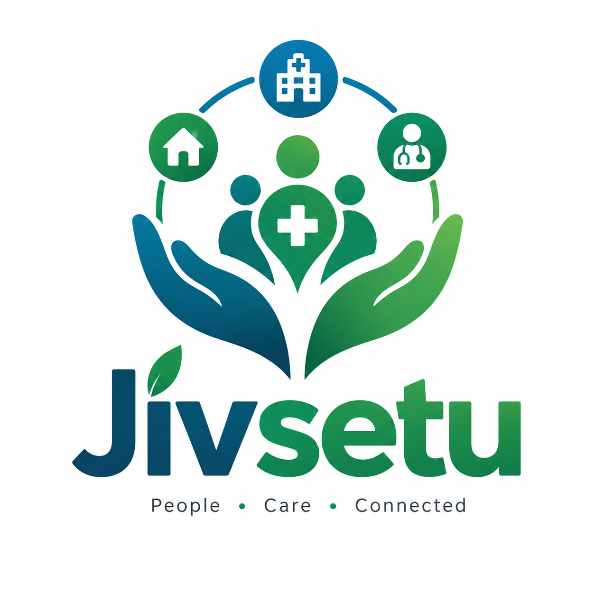
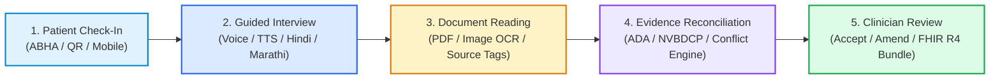
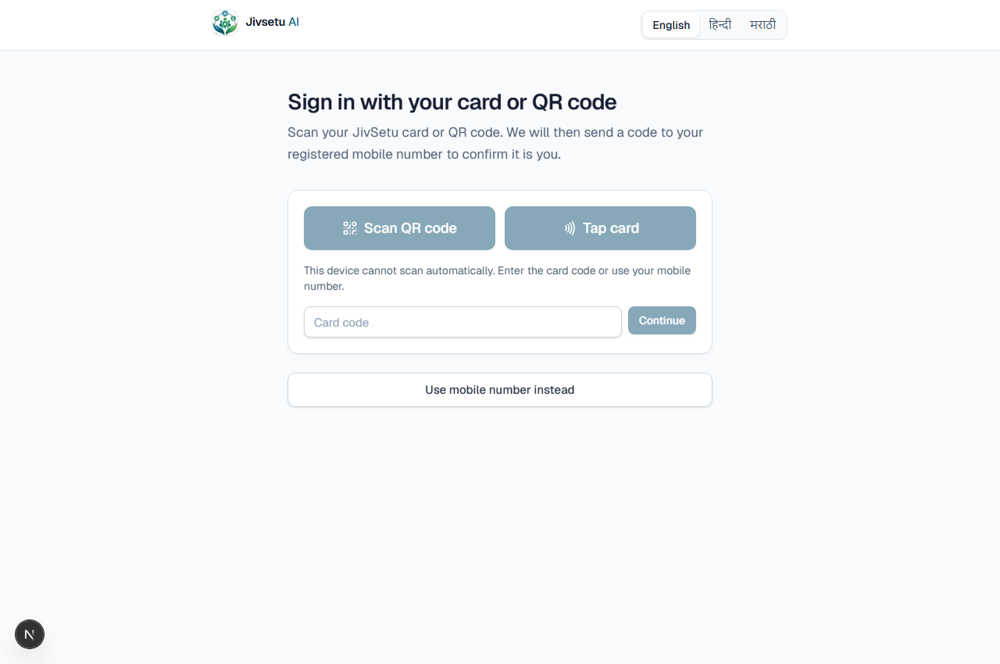
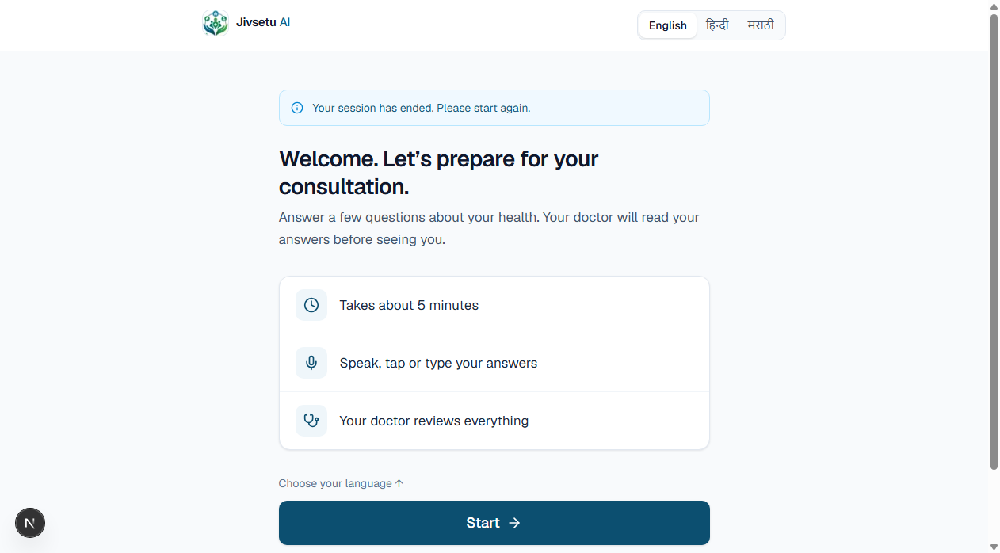
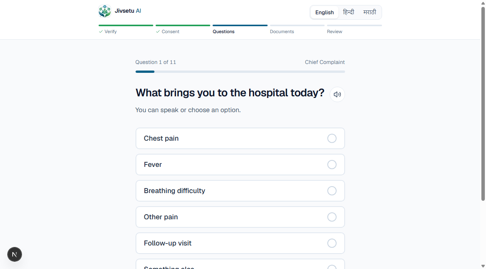
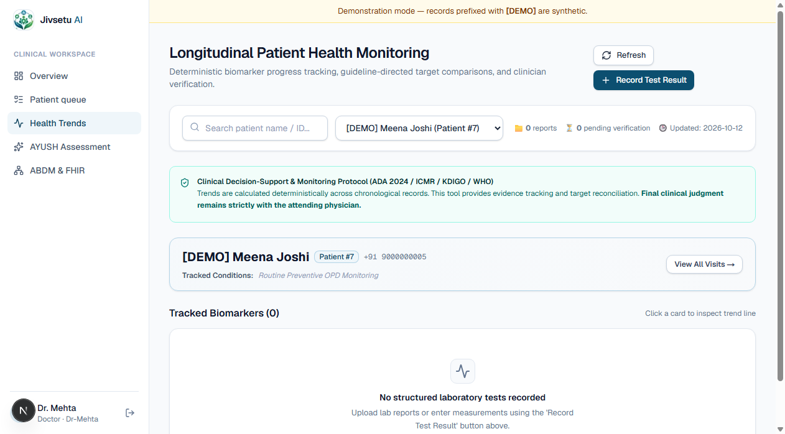
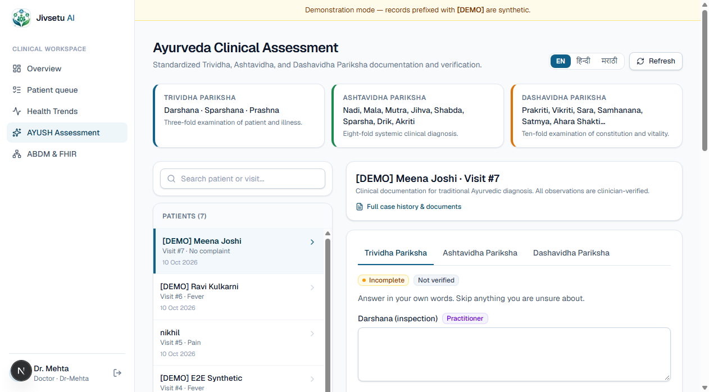
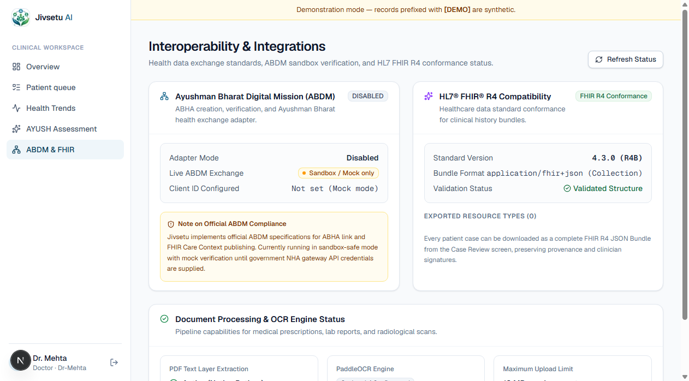
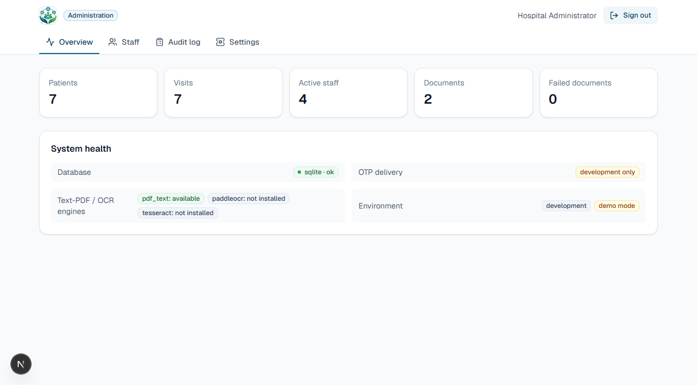
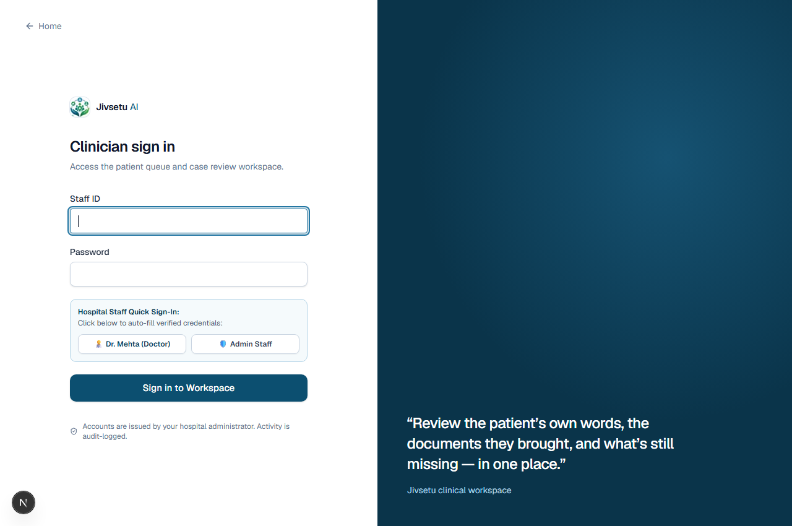

# Jivsetu MediKiosk

<div align="center">



### **AI-Assisted Multilingual Patient Case-Taking & Clinical Evidence Reconciliation Platform**
*People · Care · Connected*

[](https://web-one-ashen-q1dyjhiwl4.vercel.app/)
[-black?style=for-the-badge&logo=next.js&logoColor=white)](https://nextjs.org/)
[](https://fastapi.tiangolo.com/)
[](https://hl7.org/fhir/R4/)
[](https://abdm.gov.in/)

> *"From patient conversations to structured clinical histories — AI prepares the evidence, the clinician makes the clinical decision."*

**Live Deployed Application:** [https://web-one-ashen-q1dyjhiwl4.vercel.app/](https://web-one-ashen-q1dyjhiwl4.vercel.app/)

</div>

---

## 📌 Table of Contents
1. [Executive Summary & Problem Statement](#-executive-summary--problem-statement)
2. [Live Platform Preview](#-live-platform-preview)
3. [System Architecture & 5-Stage Clinical Pipeline](#-system-architecture--5-stage-clinical-pipeline)
4. [Exhaustive Feature Guide (with Visuals)](#-exhaustive-feature-guide-with-visuals)
   - [1. Patient Check-In & ABHA Identification](#1-patient-check-in--abha-identification)
   - [2. Multilingual Consent & Privacy Ledger](#2-multilingual-consent--privacy-ledger)
   - [3. Multilingual Guided Triage Interview & TTS](#3-multilingual-guided-triage-interview--read-aloud-tts)
   - [4. Real-Time Emergency Red-Flag Triage Engine](#4-real-time-emergency-red-flag-triage-engine)
   - [5. Medical Document Digestion & OCR Extraction](#5-medical-document-digestion--ocr-extraction)
   - [6. Clinician OPD Priority Queue](#6-clinician-opd-priority-queue)
   - [7. Side-by-Side Evidence Reconciliation & Conflict Resolver](#7-side-by-side-evidence-reconciliation--conflict-resolver)
   - [8. Longitudinal Health Monitoring & Disease Trajectory Dashboard](#8-longitudinal-health-monitoring--disease-trajectory-dashboard)
   - [9. AYUSH / Traditional Ayurveda Assessment](#9-ayush--traditional-ayurveda-clinical-assessment)
   - [10. National Interoperability (ABDM Sandbox & HL7® FHIR® R4)](#10-national-interoperability-abdm-sandbox--hl7-fhir-r4)
   - [11. Hospital Administration & Security Audit Trail](#11-hospital-administration--security-audit-trail)
   - [12. Clinician One-Click Demo Access](#12-clinician-one-click-demo-access)
5. [Clinical Reconciliation Rules & Guidelines](#-clinical-reconciliation-rules--guidelines)
6. [Technology Stack](#-technology-stack)
7. [Local Installation & Setup Guide](#-local-installation--setup-guide)
8. [Automated Verification & Pytest Suite](#-automated-verification--pytest-suite)

---

## 🏥 Executive Summary & Problem Statement

District government hospitals and high-volume outpatient departments (OPDs) in India face severe time constraints, where doctors often have **less than 2 to 3 minutes per consultation**. During this brief interaction, clinicians must simultaneously listen to patients speaking varied regional languages, decipher messy paper prescriptions and lab reports, reconcile discrepancies, identify life-threatening symptoms, and type electronic medical records.

**Jivsetu MediKiosk** resolves this clinical documentation bottleneck:
- **For Patients:** A touch- and voice-enabled hospital kiosk or mobile check-in offering intuitive clinical history-taking in English, Hindi (हिन्दी), and Marathi (मराठी) with text-to-speech (TTS) read-aloud and speech recognition.
- **For Clinicians:** A source-linked, review-ready clinical history workspace that automatically organizes patient-reported symptoms side-by-side with OCR-extracted lab values and prescriptions, flags missing or conflicting evidence, detects emergency red flags, visualizes multi-visit biomarker trajectories, and exports compliant HL7® FHIR® R4 records.
- **Strict Clinical Safety Principle:** Jivsetu is a **documentation and decision-support tool, not an autonomous diagnostic agent**. The clinician retains exclusive authority to accept, modify, or return every draft history.

---

## 🌐 Live Platform Preview


- **Official Web Application:** [https://web-one-ashen-q1dyjhiwl4.vercel.app/](https://web-one-ashen-q1dyjhiwl4.vercel.app/)
- **Patient Kiosk Workflow:** [https://web-one-ashen-q1dyjhiwl4.vercel.app/patient](https://web-one-ashen-q1dyjhiwl4.vercel.app/patient)
- **Clinician Workspace:** [https://web-one-ashen-q1dyjhiwl4.vercel.app/doctor/login](https://web-one-ashen-q1dyjhiwl4.vercel.app/doctor/login)

---

## ⚙️ System Architecture & 5-Stage Clinical Pipeline



```
┌────────────────────────────────────────────────────────────────────────┐
│                        JIVSETU DISTRIBUTED ARCHITECTURE                │
├────────────────────────────────────────────────────────────────────────┤
│  Client Tier:                                                          │
│  - Next.js 16 (App Router, Turbopack, React 19, Tailwind CSS 4)        │
│  - Web Speech API (Speech Recognition & SpeechSynthesis TTS)           │
│  - Deployed on Vercel Edge Network                                     │
├────────────────────────────────────────────────────────────────────────┤
│  API & Engine Tier:                                                    │
│  - FastAPI (Python 3.12+) Async Server on Port 8001                    │
│  - Hybrid Deterministic Clinical Rules Engine                          │
│  - Native PDF Text Layer Extraction + PaddleOCR Fallback               │
│  - HL7 FHIR R4 Bundle Generator + ABDM Sandbox Adapter                │
├────────────────────────────────────────────────────────────────────────┤
│  Data & Persistence Tier:                                              │
│  - MySQL 8.0 (Production) / SQLite (Local Development)                 │
│  - Controlled Medical Document Storage with SHA-256 Hashing            │
│  - Immutable Security Audit Log Table                                  │
└────────────────────────────────────────────────────────────────────────┘
```

---

## 📸 Exhaustive Feature Guide (with Visuals)

### 1. Patient Check-In & ABHA Identification


- **Universal Accessibility:** Patients can scan their Ayushman Bharat Digital Mission (ABDM) ABHA QR code, tap their NFC hospital card, or enter their registered 10-digit mobile number.
- **Multilingual Header:** Instant one-click language switching between **English**, **हिन्दी**, and **मराठी**.
- **Secure OTP Verification:** Re-verifies patient session securely before loading any personal medical history.
- **Minimal PII Collection:** Collects only the essential patient identity needed for care delivery.

---

### 2. Multilingual Consent & Privacy Ledger


- **Explicit Patient Consent:** Patients review clear privacy disclosures regarding how their health information is recorded and shared with their attending physician.
- **Clear Expectations:** Sets upfront expectations (*"Takes about 5 minutes"*, *"Speak, tap or type your answers"*, *"Your doctor reviews everything"*).
- **Offline-First Resilience:** Answers and draft progress are automatically saved in local browser storage; if the connection drops, progress is preserved without loss.

---

### 3. Multilingual Guided Triage Interview & Read-Aloud TTS


- **Single Question Per Screen:** High-contrast, large touch targets designed for kiosks, phones, and tablets in busy hospital environments.
- **Built-in Text-to-Speech (TTS):** Audio speaker button allows patients with low literacy to listen to the question in Hindi, Marathi, or English.
- **Voice Speech-to-Text Input:** Patients can speak their answers naturally via their microphone using the Web Speech API.
- **Adaptive Clinical Question Branching:**
  - **Fever Branch:** Tracks duration, chills/rigors, dengue warning signs (rash, bleeding, abdominal pain), and malaria risk.
  - **Chest Pain Branch:** Evaluates onset, severity, radiation to left arm/jaw, breathlessness, and diaphoresis (sweating).
  - **Respiratory Branch:** Cough type, hemoptysis, breathlessness on exertion, wheezing.
  - **Abdominal Pain Branch:** Location, intensity, relation to meals, vomiting.

---

### 4. Real-Time Emergency Red-Flag Triage Engine
```
                                 [Patient Answers]
                                         │
                   ┌─────────────────────┴─────────────────────┐
                   ▼                                           ▼
      [Chest Pain + Sweating + Radiation]             [Fever + Platelets < 100k]
                   │                                           │
                   ▼                                           ▼
    🚨 EMERGENCY RED-FLAG: ACS / AMI             ⚠️ WARNING: Dengue Thrombocytopenia
          (Independent Triage Alert)                 (NVBDCP / WHO Guideline Flag)
```

- **Deterministic Safety Guarantee:** The emergency red-flag engine executes independently of OCR pipelines or LLM network calls.
- **Immediate Alert Banners:** Patients with unstable symptoms (e.g., severe chest pain radiating to the arm with sweating) immediately trigger emergency triage indicators so hospital staff can prioritize resuscitation.

---

### 5. Medical Document Digestion & OCR Extraction
- **Multi-Format Ingestion:** Accepts camera photos, scanned JPEGs/PNGs, and multi-page PDF medical records.
- **Categorized Document Types:** Prescriptions, CBC/Biochemistry lab reports, Discharge summaries, X-ray/MRI reports, and handwritten doctor notes.
- **Source Line Provenance:** Every extracted lab value (e.g. *HbA1c: 7.8%*, *Platelets: 85,000 /µL*) is explicitly attributed to its exact file name, page number, and source line.

---

### 6. Clinician OPD Priority Queue


<div align="center">
  
  <p><em>Mobile-responsive view for on-duty clinicians and triage nurses</em></p>
</div>

- **Dynamic Priority Sorting:** Automatically surfaces emergency red-flag cases to the top of the OPD queue.
- **Comprehensive Filtering:** Filter by hospital branch, status (`Ready for review`, `Checked in`, `Reviewed`), date range, or chief complaint.
- **Queue Overview Dashboard:**
  
  - Displays total queue count, pending reviews, today's check-ins, and unreadable document alert counts in real time.

---

### 7. Side-by-Side Evidence Reconciliation & Conflict Resolver


- **Patient Story vs. Medical Evidence:** Inspects patient answers on the left directly alongside extracted laboratory values and previous prescriptions on the right.
- **Automated Conflict Detection:** Surfaces clinical discrepancies immediately (e.g., *“Conflict: patient reported no medicines, but prescription lists Metformin 500 mg BD”*).
- **Missing Information Highlighting:** Outlines incomplete or unanswered history sections so the physician knows exactly what to ask during consultation.
- **Clinician Decision Actions:**
  - **Accept History:** Commits the reconciled record with clinician digital signature.
  - **Amend Values:** Corrects any field directly; original patient answers are preserved in an audit trail.
  - **Return Case:** Rejects the history back with required explanation notes.
  - **Export FHIR R4 (JSON):** Generates an HL7-compliant FHIR R4 JSON bundle with a single click.

---

### 8. Longitudinal Health Monitoring & Disease Trajectory Dashboard


- **Multi-Visit Biomarker Tracking:** Chronologically plots key diagnostic parameters across patient hospital visits:
  - Glycemic control (HbA1c %, Fasting Blood Sugar mg/dL).
  - Cardiovascular vitals (Systolic & Diastolic Blood Pressure mmHg, Heart Rate).
  - Renal function (Serum Creatinine, eGFR).
  - Hematology (Platelet counts, Hemoglobin).
- **Guideline-Directed Clinical Target Thresholds:** Reconciles patient trends against international clinical guidelines (ADA 2024, ICMR, KDIGO, WHO).
- **Disease Progression Alerts:** Flags patients with rising biomarker trajectories or poor therapy response before acute complications arise.

---

### 9. AYUSH / Traditional Ayurveda Clinical Assessment


- **Comprehensive Ayurvedic Examination Framework:**
  - **Trividha Pariksha (Threefold Examination):**
    - *Darshana* (Inspection / Visual observation)
    - *Sparshana* (Palpation / Touch)
    - *Prashna* (Interrogation / Questioning)
  - **Ashtavidha Pariksha (Eightfold Diagnosis):**
    - *Nadi* (Pulse), *Mala* (Stool), *Mutra* (Urine), *Jihva* (Tongue), *Shabda* (Voice/Speech), *Sparsha* (Skin/Tactile), *Drik* (Eyes/Vision), *Aakriti* (General body build).
  - **Dashavidha Pariksha (Tenfold Investigation):**
    - *Prakriti*, *Vikriti*, *Sara*, *Samhanana*, *Pramana*, *Satmya*, *Satva*, *Ahara Shakti*, *Vyayama Shakti*, *Vaya*.
- **Multilingual AYUSH Terminology:** Full support for Sanskrit, Hindi, Marathi, and English terms.
- **Independent Clinical Record:** Stored in a separate, dedicated AYUSH ledger without generating unapproved automated drug prescriptions.

---

### 10. National Interoperability (ABDM Sandbox & HL7® FHIR® R4)


- **Ayushman Bharat Digital Mission (ABDM):**
  - Implements official ABDM specifications for ABHA creation, verification, and Care Context publishing.
  - Includes sandbox and mock mode for seamless demonstration without live government gateway dependencies.
- **HL7® FHIR® R4 Compatibility:**
  - Standard Version: **4.3.0 (R4B)**.
  - Generates full FHIR `Bundle` collections including:
    - `Patient`: Demographics, telecom, ABHA identifier.
    - `Encounter`: OPD visit metadata, service provider, status.
    - `Condition`: Active clinical complaints and diagnostic flags.
    - `Observation`: Structured vital signs and lab results.
    - `DocumentReference`: Attached prescriptions and medical reports.

---

### 11. Hospital Administration & Security Audit Trail


- **Live Operational Metrics:** Real-time visibility into registered patients, total visits, active staff members, and processed documents.
- **System Health Monitor:** Real-time status indicators for database health, OTP delivery mechanisms, OCR engines, and environment modes.
- **Staff Access Management:** Create and provision doctor, nurse, and administrative accounts with hospital-level data isolation.
- **Immutable Security Audit Log:** Audit-logs every login, case review, patient record amendment, and data export with timestamps and user IDs.

---

### 12. Clinician One-Click Demo Access


- **Instant Evaluation:** One-click credential autofill buttons for evaluation and hackathon presentations:
  - **👨‍⚕️ Dr. Mehta (Doctor):** Username `dr-mehta`, Password `Doctor@12345`
  - **🛡️ Admin Staff:** Username `admin`, Password `Admin@12345`
- **Role Isolation:** Enforces strict role-based route guards across `/doctor/*` and `/admin/*`.

---

## 🔬 Clinical Reconciliation Rules & Guidelines

| Condition | Diagnostic Rule / Trigger | Guideline Cited | Engine Action |
|---|---|---|---|
| **Diabetes Mellitus** | HbA1c $\ge 6.5\%$ OR Fasting Glucose $\ge 126\text{ mg/dL}$ | **ADA Standards of Care 2026** | Flags Diabetes Range consideration; links exact lab line. |
| **Prediabetes** | HbA1c $5.7\% - 6.4\%$ OR Fasting Glucose $100 - 125\text{ mg/dL}$ | **ADA Standards of Care 2026** | Explicitly flags **Prediabetes Range**; never labels as diabetes. |
| **Acute Coronary Syndrome** | Severe chest pain + radiation to left arm + diaphoresis | **ACC / AHA ACS Guidelines** | Fires immediate Emergency Red Flag screening alert. |
| **Dengue Warning** | Fever $\ge 3\text{ days}$ + Platelets $< 100,000/\mu\text{L}$ | **NVBDCP / WHO Dengue Guidelines** | Triggers Dengue warning threshold for immediate hydration monitoring. |
| **Drug Discrepancy** | Patient reports "No Meds" but document lists Metformin | **Patient Safety Best Practice** | Surfaces explicit conflict card with document quote. |

---

## 💻 Technology Stack

### Frontend
- **Framework:** Next.js 16.3 (Turbopack, App Router)
- **Library:** React 19, TypeScript
- **Styling:** Tailwind CSS 4, Lucide React Icons
- **Voice APIs:** Web Speech API (`SpeechRecognition` & `SpeechSynthesis`)

### Backend API
- **Framework:** FastAPI (Python 3.12+)
- **ORM & Validation:** SQLAlchemy 2.0, Pydantic v2
- **Authentication:** JWT (PyJWT), Password Hashing (Argon2 / pwdlib)
- **Document OCR:** `pypdf` (Native text extraction), PaddleOCR (Optional image engine)
- **Health Standards:** `fhir.resources` (HL7 FHIR R4), ABDM Mock Adapter

### Database
- **Production:** MySQL 8.0
- **Development & Testing:** SQLite (`jivsetu_dev.db`)

---

## 🚀 Local Installation & Setup Guide

### Prerequisites
- **Node.js** 20.x or higher
- **Python** 3.12+
- **Git**

### 1. Clone Repository (Single `main` branch)
```bash
git clone -b main https://github.com/Nickroy07/JivSetu.git
cd JivSetu/web
```

### 2. Backend Setup
```powershell
cd backend

# Create and activate Python virtual environment
python -m venv .venv
.\.venv\Scripts\activate

# Install dependencies
pip install -r requirements.txt -r requirements-dev.txt pytest httpx

# Configure environment
cp .env.example .env

# Initialize database and seed demo data
python init_db.py --demo

# Start FastAPI server on port 8001
uvicorn app.main:app --host 127.0.0.1 --port 8001
```
- API Health Check: `http://127.0.0.1:8001/health`
- Interactive Swagger Docs: `http://127.0.0.1:8001/docs`

### 3. Frontend Setup
Open a second terminal:
```powershell
# In web directory
npm install

# Set local API target
Set-Content -Path .env.local -Value "NEXT_PUBLIC_API_URL=http://127.0.0.1:8001"

# Run development server
npm run dev
```
Open `http://localhost:3000` in your web browser.

---

## 🧪 Automated Verification & Pytest Suite

Run the comprehensive backend test suite:
```powershell
cd backend
.\.venv\Scripts\python.exe -m pytest -v
```

**Test Coverage Highlights:**
- `test_disease_rules.py`: Validates ADA Diabetes vs. Prediabetes criteria, ACC/AHA chest pain triage, and NVBDCP Dengue thresholds.
- `test_conflict_resolution.py`: Verifies automated discrepancy detection between patient interviews and prescriptions.
- `test_trend_analysis.py`: Verifies multi-visit longitudinal biomarker calculation and trajectory alert algorithms.
- `test_health_monitoring_router.py`: End-to-end integration tests for doctor health trends API.
- `test_ai_draft.py`: Tests clinical draft summary composition and provenance linkage.

---

<div align="center">

**Jivsetu AI — People · Care · Connected**  
*Built for resilient healthcare delivery in district hospitals and outpatient departments.*

[Return to Top ⬆](#jivsetu-medikiosk)

</div>
