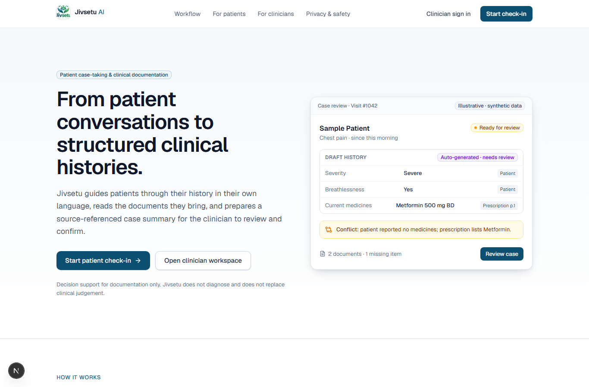
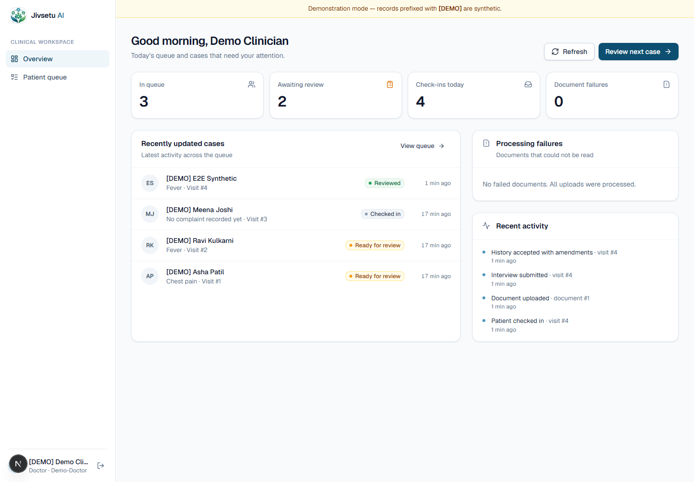
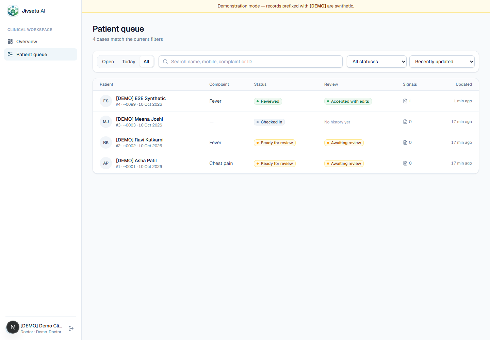
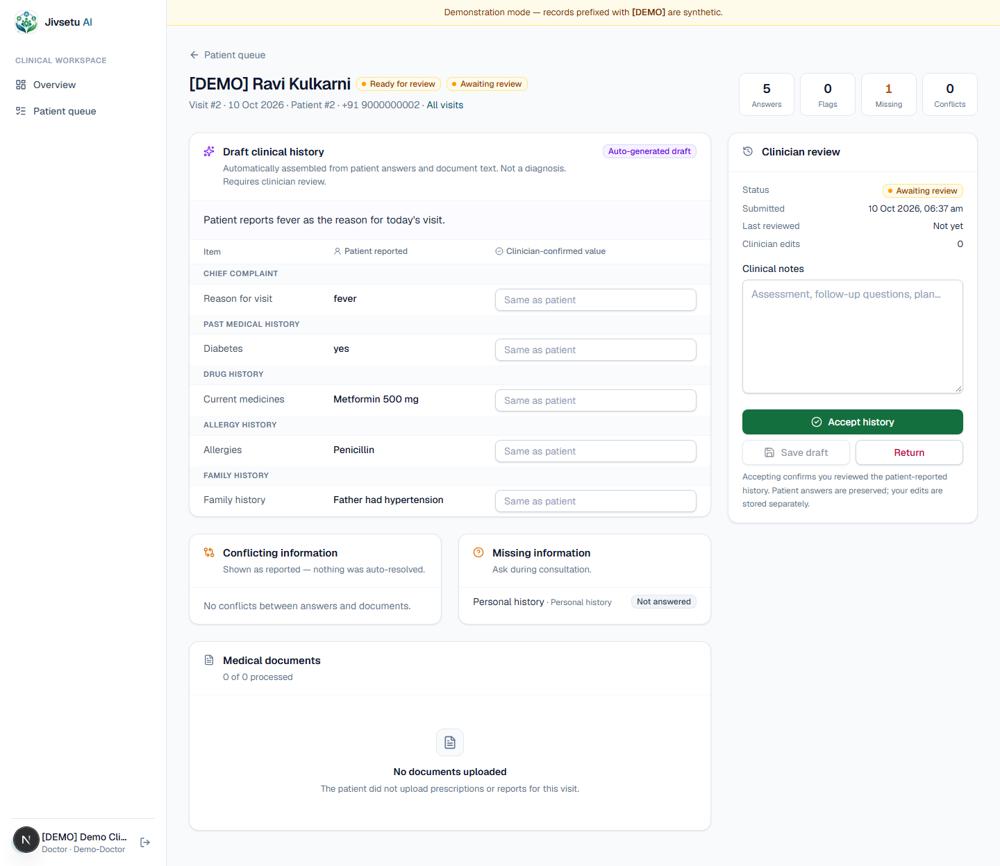
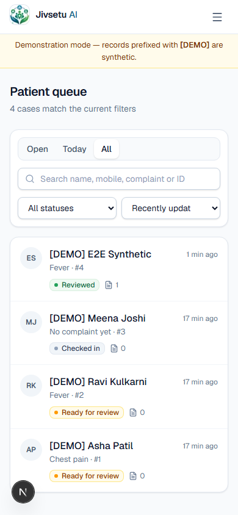

# Jivsetu AI

**From patient conversations to structured clinical histories.**

ABDM provides the digital-health interoperability ecosystem; Jivsetu addresses the
patient-facing data-collection bottleneck by converting voice, touch, text and medical
documents into structured, verified clinical information that can be designed for
FHIR/ABDM interoperability.

Patients answer a guided, multilingual (English / हिन्दी / मराठी) interview and upload
prescriptions or reports. Jivsetu extracts what it can from the documents, checks for
missing and conflicting information, and prepares a **draft** clinical history that a
clinician reviews, corrects and accepts. Drafts are never presented as a diagnosis, and
Jivsetu does not replace clinical judgement.

## Features

**Patient**
- Mobile-number sign-in with OTP (SMS via MSG91; clearly labelled dev mode locally)
- Guided, one-question-at-a-time interview in English, Hindi and Marathi, with voice input where the browser supports it
- Red-flag symptom detection with urgent-care guidance
- Prescription / report upload with live progress, processing status and retry
- Review-and-correct step before submission, and a genuine confirmation screen

**Doctor**
- Overview with real queue counts, cases awaiting review, processing failures and recent activity
- Patient queue with search, filters, sorting and pagination
- Case review that separates *patient-reported*, *document-extracted*, *auto-generated draft* and *clinician-confirmed* information
- Missing-information and conflict checks with source references to the uploaded document
- Accept / return / save draft, with edits persisted and review timestamps shown
- Full visit history per patient

## Screenshots

All data shown is synthetic demo data (prefixed `[DEMO]`).

| Landing page | Doctor overview |
|---|---|
|  |  |
| **Patient queue** | **Case review** |
|  |  |

<p align="center"></p>

## Architecture

| Part | Stack | Folder |
|---|---|---|
| Frontend | Next.js 16 (App Router), React, Tailwind CSS 4 | `./` |
| Backend API | FastAPI, SQLAlchemy 2, Argon2, JWT | `backend/` |
| Database | MySQL 8 (production) or SQLite (local development) | `sql/`, `backend/init_db.py` |
| Documents | Text-layer PDFs via `pypdf`; images/scanned PDFs need optional PaddleOCR | `backend/app/services/` |

```
Patient (browser) ──► Next.js frontend ──► FastAPI API ──► MySQL / SQLite
                                              │
                                              ├─► document storage (private volume)
                                              ├─► PDF text / OCR extraction
                                              └─► OTP provider (MSG91)
```

## Project structure

```
app/            Next.js routes (landing, /patient/*, /doctor/*)
components/     UI primitives (components/ui) and doctor/patient shells
lib/            API client, interview question bank, translations, status helpers
backend/app/    FastAPI app: routers, models, services (OCR, OTP, case summary), security
backend/tests/  pytest suite (temporary SQLite DB, synthetic data)
sql/            MySQL schema and upgrade scripts
docs/           Screenshots
```

## Local setup

Requirements: Node 20+, Python 3.12+, and optionally MySQL 8.

### 1. Backend

```bash
cd backend
python -m venv .venv
.venv/Scripts/activate            # Windows   (macOS/Linux: source .venv/bin/activate)
pip install -r requirements-dev.txt
# optional, ~1 GB, enables image / scanned-PDF OCR:
# pip install -r requirements-ocr.txt

cp .env.example .env              # then edit .env
python -c "import secrets; print(secrets.token_urlsafe(48))"   # paste into JWT_SECRET_KEY
```

Set `DATABASE_URL` in `backend/.env`:

- MySQL: `mysql+pymysql://jivsetu_app:<password>@127.0.0.1:3306/jivsetu?charset=utf8mb4`
- No MySQL available: `sqlite:///./jivsetu_dev.db`

Create the schema (and, for demos only, synthetic data):

```bash
python init_db.py                                  # schema + default hospital
python init_db.py --staff dr-mehta --name "Dr Mehta"   # create a doctor account (prompts for password)
python init_db.py --demo                           # requires DEMO_MODE=true; prints a one-time demo doctor password
```

Start the API (port 8001 is used locally because 8000 may be taken by another service):

```bash
uvicorn app.main:app --host 127.0.0.1 --port 8001
```

- Health: http://127.0.0.1:8001/health (reports DB backend/status, OTP provider, OCR engines, demo mode)
- API docs: http://127.0.0.1:8001/docs

### 2. Frontend

```bash
npm install
# .env.local
echo NEXT_PUBLIC_API_URL=http://127.0.0.1:8001 > .env.local
npm run dev                       # http://localhost:3000
```

`NEXT_PUBLIC_API_URL` is inlined at build time; there is no localhost fallback in
production builds — the UI shows an explicit configuration error instead.

## Routes

| Path | Purpose |
|---|---|
| `/` | Product landing page |
| `/patient` → `register` → `otp` → `consent` → `interview` → `documents` → `complete` | Guided patient flow |
| `/doctor/login` | Staff sign-in |
| `/doctor` | Overview: queue counts, awaiting review, processing failures, recent activity |
| `/doctor/queue` | Search, filter, sort and paginate cases |
| `/doctor/cases/[visit_id]` | Case review: patient-reported vs clinician-confirmed values, missing info, conflicts, documents with source references, accept / return / save draft |
| `/doctor/patient/[patient_id]` | Patient visit history |

Main API groups: `/auth`, `/auth/patient` (OTP), `/patient`, `/documents`, `/doctor`
(staff only), `/clinical-history`.

## Tests

```bash
cd backend && python -m pytest -q        # uses a temporary SQLite DB and synthetic data
npx tsc --noEmit && npm run lint && npm run build
```

## Security notes

- Passwords hashed with Argon2; JWTs signed with `JWT_SECRET_KEY` (required, read from env).
- `/doctor/*` requires a staff token; patients can only read their own visits and documents.
- Uploads: JPEG/PNG/WebP/PDF only, size limit `MAX_UPLOAD_MB`, magic-byte check, random
  server-side filenames, stored outside the web root, served only through authorised endpoints.
- `OTP_PROVIDER=dev` shows the code on screen and is labelled as development-only; it is
  refused when `ENVIRONMENT=production`. Use `msg91` with real credentials for SMS.
- `/auth/login` and `/auth/patient/verify-otp`: 10 attempts per IP per 5 minutes (in-memory, per process); `send-otp` is also limited per mobile number.
- CORS is an explicit allow-list (`CORS_ORIGINS`). Production errors return no stack traces.
- At startup in production the API refuses to run with SQLite, dev OTP, `DEMO_MODE=true`,
  or localhost CORS origins.

See `backend/security-roadmap.md` for what is not yet implemented (shared/multi-instance rate limiting,
encryption at rest, consent management, formal compliance review).

## Deployment

The frontend and backend deploy **separately**; deploying one does not deploy the other.

1. **Database** — provision MySQL 8, create a dedicated user, then either run
   `python init_db.py` against it or apply `sql/00_schema_mysql.sql`
   (existing pre-v1 databases: `sql/06_upgrade_v1.sql`).
2. **Backend** — any host that runs Python (VM, container, Render, Railway, etc.):
   - env: `ENVIRONMENT=production`, `JWT_SECRET_KEY`, MySQL `DATABASE_URL`,
     `CORS_ORIGINS=https://<frontend-domain>`, `OTP_PROVIDER=msg91` + `MSG91_*`,
     `DEMO_MODE=false`, `DOCUMENT_STORAGE_PATH` on a **persistent** volume.
   - start: `uvicorn app.main:app --host 0.0.0.0 --port 8001 --workers 2` behind an HTTPS reverse proxy.
   - health check: `GET /health`.
   - install `requirements-ocr.txt` only if image OCR is needed (large).
3. **Frontend** — Vercel or `npm run build && npm start`, with
   `NEXT_PUBLIC_API_URL=https://<api-domain>` set **before** the build.

Still required before a real deployment: a MySQL instance, an SMS provider account,
TLS/domains, a persistent document volume, and backups.

## Demo login (local only)

`python init_db.py --demo` (with `DEMO_MODE=true`) creates synthetic `[DEMO]` patients and
a `demo-doctor` account and prints its random password once. There are no built-in
default accounts. Never enable demo mode in production.

## License

MIT — see [LICENSE](LICENSE).
